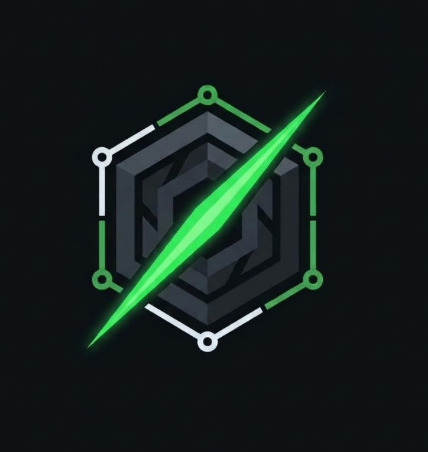

  

<h1 align="center">SiloBeam</h1>

  <strong>Zero-Trust, Offline-First LAN File & Note Transfer</strong> 
  Built with Rust, Tauri, Noise_IK E2EE, and mDNS. Zero cloud. Zero tracking.

---

## Security Architecture
* **End-to-End Encryption:** Mutual authentication and encrypted transport using the **Noise Protocol (`Noise_IK`)** handshake over raw TCP.
* **Zero-Cloud Discovery:** Automatic local peer discovery via **mDNS**—no relay servers, accounts, or internet access required.
* **Chunked Streaming:** Large files stream in **48KB Noise-encrypted frames** with live transfer progress and minimal RAM overhead.
* **Path-Traversal Safe:** Incoming filenames are strictly sanitized via `Path::file_name()` before writing to `Downloads/SiloBeam`.

## Repository Structure
* `crates/lan-core` — Core Rust library (Noise_IK crypto, framing protocol, mDNS discovery, SQLite storage).
* `apps/lanpad` — Cross-platform Tauri GUI for Windows and Android.

## Build & Run

### Desktop (Windows)
~~~powershell
cd apps/lanpad
cargo tauri dev
~~~

### Android (APK)
~~~powershell
cd apps/lanpad
cargo tauri android build --debug --apk --target aarch64
~~~

## Author
Built by **Abhinandan Pandey** — [GitHub](https://github.com/abhinandanpandey-in) | [Portfolio](https://abhinandanpandey-in-github-io.pages.dev)